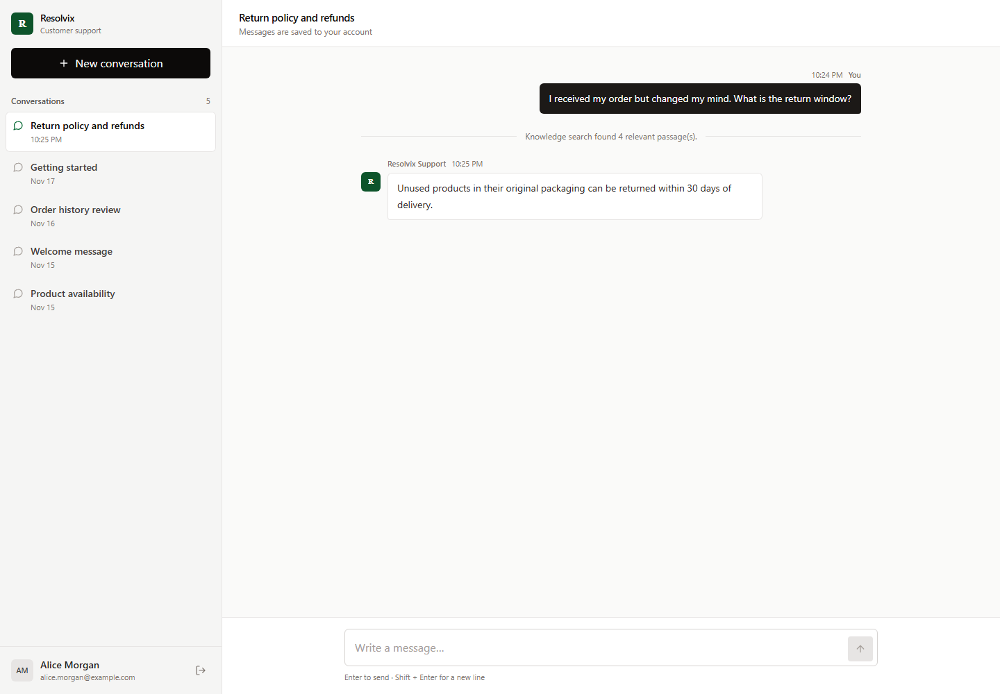
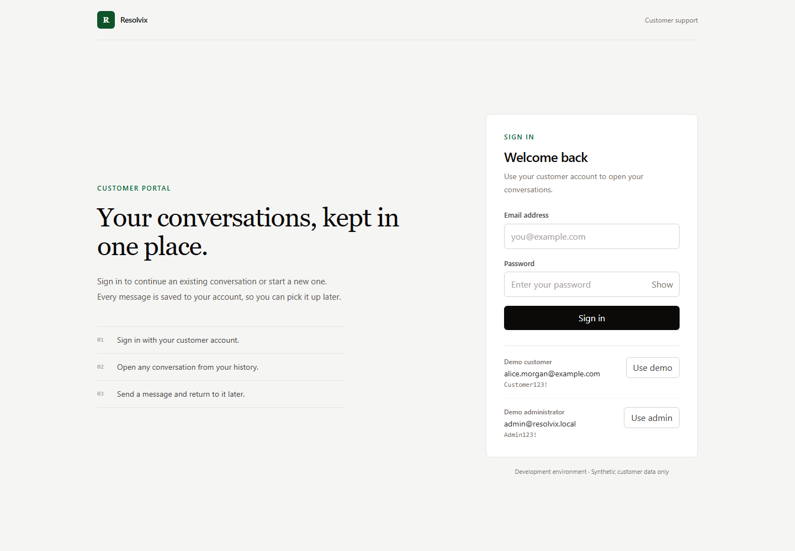
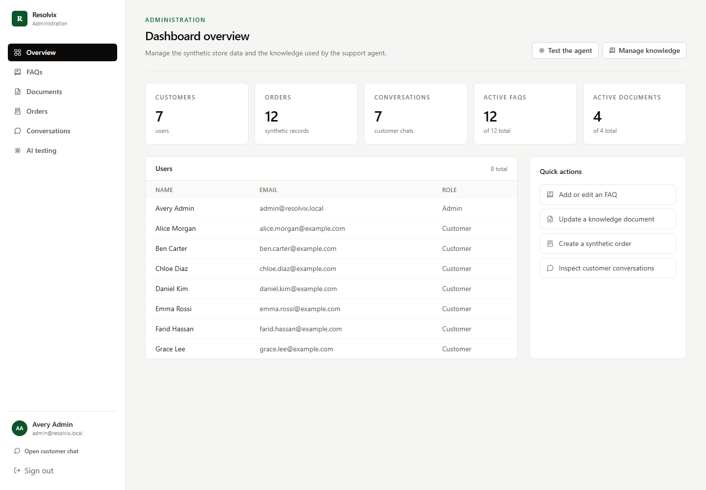
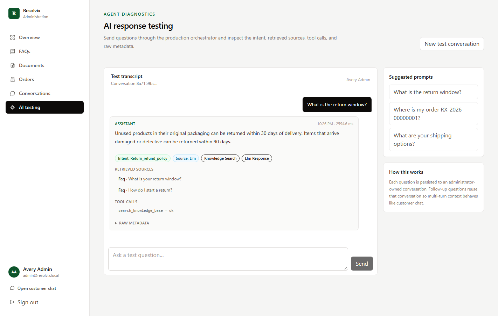
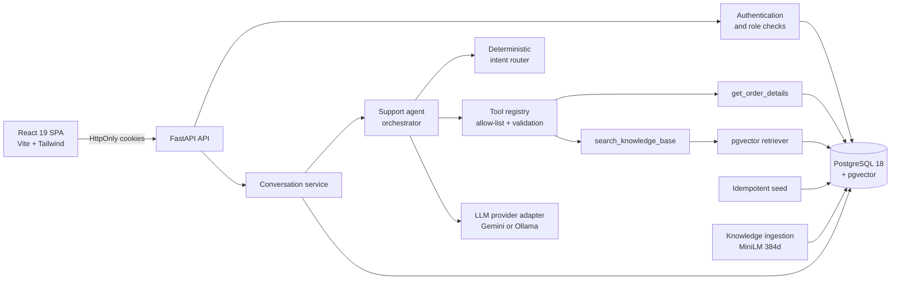
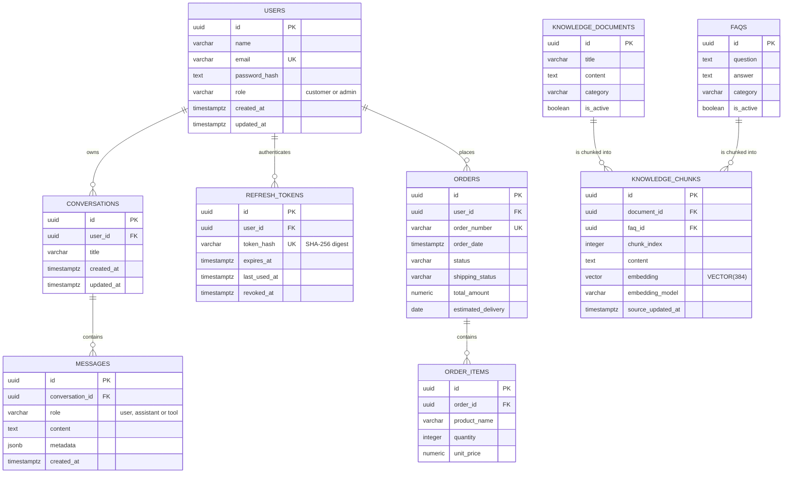

# Resolvix

**AI customer support that only answers from data it is allowed to see.**

Resolvix is a full-stack, standalone support application: a React customer
portal, a FastAPI backend, a controlled tool-calling agent, and PostgreSQL with
pgvector for semantic retrieval. Customers can ask about their own orders or
store policies; the agent can only call two registered tools, always scoped to
the signed-in customer.



## The problem

Most "AI support" demos fail in the places that matter in production:

- the model can invent policies or claim an order status it never looked up;
- customer identity leaks into model arguments;
- an embedding, retrieval, database, or provider outage becomes a stack trace;
- there is no audit trail explaining why an answer was produced;
- the app only runs on the author's laptop.

Resolvix treats the model as one bounded component. Routing, authorization,
tool execution, retrieval, persistence, and failure handling stay in
application code.

## What it does

- **Cookie-based authentication** with short-lived access JWTs, opaque rotating
  refresh sessions stored as SHA-256 hashes, and role-aware admin access.
- **Customer-scoped order assistant**: order numbers are the only model-supplied
  argument; the customer id always comes from the verified token.
- **Grounded policy answers** with citations from FAQs and long-form documents,
  retrieved from pgvector with cosine distance and an HNSW index.
- **Deterministic routing** for order, return/refund, shipping, payment, and
  general intents, including follow-up context reuse.
- **Controlled tool loop** with an allow-list, argument validation, duplicate
  detection, round/call limits, and a safe fallback when the provider fails.
- **Admin console** for users, synthetic orders, FAQs, knowledge documents,
  conversations, and an agent diagnostic view that exposes intent, sources, tool
  calls, and metadata.
- **Structured observability**: every request and agent turn carries correlation
  ids, and each boundary emits a JSON log event.
- **One-command Docker stack** with PostgreSQL 18 + pgvector, automatic
  migrations, idempotent seed data, knowledge indexing, and optional Ollama.

## Screenshots

| Login | Admin dashboard |
|---|---|
|  |  |

| Customer conversation | Agent diagnostics |
|---|---|
|  |  |

## Architecture



### Boundaries

| Boundary | Responsibility | Implementation |
|---|---|---|
| HTTP | Validation, cookies, status codes | `backend/app/api/` |
| Service | Ownership checks and persistence | `backend/app/services/` |
| Agent | Context, routing, tool loop, fallback | `backend/app/ai/orchestrator.py` |
| Provider | Vendor-specific LLM translation | `backend/app/ai/providers/` |
| Tools | Allow-listed backend capabilities | `backend/app/tools/` |
| Retrieval | Embedding + pgvector search | `backend/app/knowledge/` |
| Database | Relational data and vectors | `backend/app/repositories/`, `migrations/` |

A customer turn flows through the API → service → orchestrator. The orchestrator
resolves one intent, runs only the approved preflight capability, offers only
that route's tools to the model, validates every requested call again, persists
the reply and audit metadata, and returns a controlled result even when a
provider or tool fails.

See [`docs/agent-orchestration.md`](docs/agent-orchestration.md) for routing and
failure-handling details.

## Data model



The full schema, constraints, indexes, and delete behaviour are documented in
[`docs/database-design.md`](docs/database-design.md). PostgreSQL stores both
relational data and vectors; there is no separate vector service.

## Tech stack

| Layer | Technology |
|---|---|
| Frontend | React 19, Vite 8, Tailwind CSS 4, React Router 7, Axios |
| Backend | Python 3.14, FastAPI, Pydantic 2, SQLAlchemy 2 |
| Database | PostgreSQL 18, pgvector 0.8, HNSW cosine index |
| Auth | PyJWT, Argon2id, HttpOnly cookies, hashed refresh tokens |
| AI | Gemini (`google-genai`) or Ollama, provider-neutral adapter |
| RAG | sentence-transformers `all-MiniLM-L6-v2` (384 dimensions) |
| Migrations | Alembic |
| Tests | pytest, Vitest, Testing Library |
| Packaging | Docker multi-stage builds, nginx, Docker Compose |

## Repository layout

```text
Resolvix/
├── backend/
│   ├── app/
│   │   ├── ai/            # Orchestrator, routing, context, providers
│   │   ├── api/           # FastAPI routes, dependencies, middleware
│   │   ├── core/          # Settings, security, structured logging
│   │   ├── db/            # Engine, session, declarative base
│   │   ├── knowledge/     # Chunking, embeddings, retrieval, ingestion
│   │   ├── models/        # SQLAlchemy models
│   │   ├── repositories/  # Ownership-scoped queries
│   │   ├── services/      # Conversation application service
│   │   └── tools/         # Tool contracts and the allow-list registry
│   ├── migrations/        # Alembic revisions
│   ├── scripts/           # seed.py, index_knowledge.py, verify.py
│   └── tests/             # Unit, integration, API, RAG, migration tests
├── frontend/
│   └── src/               # Customer chat, login, admin console
├── docs/                  # Architecture, database, pgvector, screenshots
├── docker-compose.yml
└── .env.example
```

## Quick start with Docker

Requirements: Docker Desktop with Compose v2.

```powershell
Copy-Item .env.example .env
# Generate a secret and paste it after JWT_SECRET_KEY= in .env:
python -c "import secrets; print(secrets.token_urlsafe(48))"
# Also change POSTGRES_PASSWORD in .env.
docker compose up --build
```

| Service | URL |
|---|---|
| Customer portal | <http://localhost:5173> |
| API | <http://localhost:8000> |
| Swagger UI | <http://localhost:8000/docs> |
| ReDoc | <http://localhost:8000/redoc> |
| Health | <http://localhost:8000/health> |

On first boot the backend container waits for PostgreSQL, runs
`alembic upgrade head`, seeds synthetic users/orders/FAQs/documents, downloads
the embedding model, and indexes all knowledge sources. This can take a few
minutes; the model is cached in the `hf_cache` volume on later starts.

Useful commands:

```powershell
docker compose ps
docker compose logs -f backend
docker compose down
docker compose down -v      # also removes database and model-cache volumes
```

### Optional local LLM (Ollama)

```powershell
docker compose --profile ollama up -d ollama
docker compose exec ollama ollama pull llama3.2:3b
# Set LLM_PROVIDER=ollama in .env, then:
docker compose up -d backend frontend
```

Without `GEMINI_API_KEY` or Ollama, the app still starts; agent turns return the
safe fallback reply instead of failing the request.

## Demo accounts

| Role | Email | Password |
|---|---|---|
| Customer | `alice.morgan@example.com` | `Customer123!` |
| Administrator | `admin@resolvix.local` | `Admin123!` |

All data is synthetic. Other seeded customers use the same customer password.
The login screen includes **Use demo** and **Use admin** shortcuts for local
development.

## Local development

### Prerequisites

- Python 3.14
- Node.js 20 or newer (developed with Node 24)
- PostgreSQL 18 with the `vector` extension
- A Gemini API key or a local Ollama installation

If PostgreSQL does not have pgvector yet, follow
[`docs/pgvector-setup.md`](docs/pgvector-setup.md).

### Backend

```powershell
cd backend
python -m venv venv
.\venv\Scripts\Activate.ps1
python -m pip install -r requirements.txt
Copy-Item .env.example .env
# Edit DATABASE_URL, JWT_SECRET_KEY, and GEMINI_API_KEY in .env
python -m alembic upgrade head
python -m scripts.seed
python -m scripts.index_knowledge
uvicorn app.main:app --reload --port 8000
```

### Frontend

```powershell
cd frontend
npm install
Copy-Item .env.example .env
npm run dev
```

Vite serves <http://localhost:5173>. `VITE_API_BASE_URL` defaults to
`http://localhost:8000`; add the frontend origin to the backend's
`CORS_ORIGINS` if you use a different host or port.

## Configuration

Secrets belong in `.env` files and are never committed. Start from
[`backend/.env.example`](backend/.env.example) for local development or
[`.env.example`](.env.example) for Docker Compose.

| Variable | Default | Purpose |
|---|---|---|
| `DATABASE_URL` | required | `postgresql+psycopg://...` connection |
| `JWT_SECRET_KEY` | required | Access-token signing secret, at least 32 characters |
| `ACCESS_TOKEN_EXPIRE_MINUTES` | `30` | Access JWT/cookie lifetime |
| `REFRESH_TOKEN_EXPIRE_DAYS` | `30` | Sliding refresh-session lifetime |
| `COOKIE_SECURE` | `false` | Set `true` for HTTPS deployments |
| `CORS_ORIGINS` | localhost:5173 | JSON list of allowed browser origins |
| `LLM_PROVIDER` | `gemini` | `gemini` or `ollama` |
| `LLM_MODEL` / `GEMINI_API_KEY` | Gemini defaults | Hosted model configuration |
| `OLLAMA_BASE_URL` / `OLLAMA_MODEL` | localhost / llama3.2:3b | Local inference |
| `EMBEDDING_MODEL` | all-MiniLM-L6-v2 | Must produce 384 dimensions |
| `RAG_TOP_K` / `RAG_MAX_DISTANCE` | `4` / `0.7` | Retrieval breadth and cutoff |
| `AGENT_MAX_HISTORY_MESSAGES` | `40` | Bounded provider context |
| `AGENT_MAX_TOOL_ROUNDS` / `_CALLS` | `3` / `6` | Tool-loop limits |
| `LOG_LEVEL` / `LOG_FORMAT` | `INFO` / `json` | Structured logging |
| `SEED_DATABASE` / `INDEX_KNOWLEDGE` | `true` | Docker first-boot steps |

## Database lifecycle

```powershell
cd backend
python -m alembic upgrade head        # apply migrations
python -m alembic current             # show current revision
python -m scripts.seed                # idempotent synthetic data
python -m scripts.index_knowledge     # chunk + embed + sync pgvector
python -m scripts.index_knowledge --force
```

Migrations are explicit revisions (`0001` through `0003`). The initial revision
creates the `vector` extension, so a fresh database only needs the extension
binary installed. Knowledge ingestion is source-version aware: unchanged
sources are skipped, edited sources are re-embedded, deactivated sources have
their chunks removed, and retrieval ignores chunks whose source version is stale.

## API

Interactive documentation is served at `/docs` (Swagger UI) and `/redoc`.
Authentication uses `POST /auth/login`; the API sets HttpOnly
`resolvix_access` and `resolvix_refresh` cookies and also returns a bearer token
for scripted clients. Customer identity is always derived from the token.

| Area | Endpoints |
|---|---|
| Health | `GET /health` |
| Auth | `POST /auth/login`, `POST /auth/refresh`, `GET /auth/me`, `POST /auth/logout` |
| Conversations | `GET/POST /conversations`, `GET /conversations/{id}`, `GET/POST /conversations/{id}/messages` |
| Orders | `GET /orders`, `GET /orders/{order_number}` |
| Admin | `/admin/users`, `/admin/stats`, `/admin/orders`, `/admin/knowledge/*`, `/admin/conversations`, `/admin/ai/test` |

Example:

```powershell
$session = New-Object Microsoft.PowerShell.Commands.WebRequestSession
Invoke-RestMethod -Method Post -Uri http://localhost:8000/auth/login `
  -WebSession $session -ContentType application/json `
  -Body '{"email":"alice.morgan@example.com","password":"Customer123!"}'

Invoke-RestMethod -Method Post -Uri http://localhost:8000/conversations `
  -WebSession $session -ContentType application/json `
  -Body '{"title":"Order question"}'
```

## Testing

### Backend

```powershell
cd backend
.\venv\Scripts\python.exe -m pytest -q
```

The suite covers:

- password hashing, JWT validation, cookie refresh, role checks, and ownership
  helpers;
- repository/service functions, bounded message windows, order ownership, and
  administrative authorization;
- conversation, message, order, FAQ, knowledge, and admin APIs;
- chunking, embedding dimensions, retrieval relevance, active/inactive source
  filtering, stale-chunk exclusion, and knowledge synchronization;
- tool registry allow-listing, argument validation, unknown tools, duplicates,
  call limits, and orchestration fallbacks;
- mocked provider success plus timeout, rate-limit, malformed-response,
  unavailable-model, and authentication failures (no live LLM quota is used);
- safe handling of independent database, retrieval, embedding, and LLM
  failures, including sanitized HTTP responses and structured log events;
- Alembic migrations and database constraints against a disposable PostgreSQL
  database.

The migration tests need a PostgreSQL server with the `vector` extension. When
the local server does not provide it, those three tests skip with an explicit
reason; the Compose database uses the `pgvector/pgvector:pg18` image and runs
them without changes.

### Frontend

```powershell
cd frontend
npm run lint
npm test
npm run build
```

### Verification status

- Backend: 208 tests pass and 3 migration tests skip with an explicit reason on
  the development PostgreSQL; all 211 pass against a pgvector-enabled
  PostgreSQL 18 instance. Frontend: 15 tests, lint, and the production build
  pass.
- A fresh database was created from scratch, migrated with `alembic upgrade
  head`, seeded, and indexed (16 sources, 20 chunks); health, authentication,
  authorization, orders, admin stats, and retrieval checks passed against it.
- The Compose file validates against the Compose specification schema and the
  Dockerfiles were checked statically. Docker runtime verification requires
  Docker Desktop, which was not available in the development environment used
  to prepare this release.

## Observability

Every HTTP response includes `X-Request-ID` (caller-supplied values are accepted
only when short and log-safe). Incoming request ids flow through all logs; each
agent turn adds a separate operation id so a provider/tool sequence can be
correlated independently of the request.

Logs are one JSON object per line by default:

```json
{
  "timestamp": "2026-11-18T18:24:19.812Z",
  "level": "INFO",
  "logger": "app.ai.orchestrator",
  "message": "Agent turn completed",
  "request_id": "7f75c90a8ab34f21b5741833f4be4d61",
  "operation_id": "op_5f4c0a2d8e1b479c",
  "event": "agent_turn",
  "intent": "return_refund_policy",
  "source": "llm",
  "provider": "gemini",
  "retrieved_count": 2,
  "fallback": false,
  "duration_ms": 1832.4
}
```

Boundary events include `http_request`, `database_health`, `database_error`,
`agent_turn`, `provider_call`, `provider_error`, `tool_attempt`,
`tool_execution`, `tool_rejected`, `retrieval_completed`, `knowledge_sync`, and
`knowledge_sync_error`. Query text, prompts, passwords, tokens, and raw database
URLs are not logged. Set `LOG_FORMAT=text` for a compact terminal format.

### Failure isolation

| Failure | Customer-visible result | Server-side result |
|---|---|---|
| PostgreSQL unavailable | sanitized `503` with request id | `database_error` log with stack trace |
| Retrieval/embedding failure | ungrounded "cannot confirm" reply | `retrieval_error` / `knowledge_sync_error` |
| Provider timeout or rate limit | safe fallback reply | `provider_error` + `agent_fallback` |
| Invalid tool arguments | controlled tool error | `tool_rejected` |
| Unknown tool | no backend execution | `tool_rejected` with the requested name |
| Emergency lookup failure followed by a status claim | guarded replacement reply | `agent_fallback` / tool metadata |

## Security model

- Passwords use salted Argon2id hashes; legacy PBKDF2 hashes upgrade on login.
- Access tokens are short-lived and typed; refresh tokens are opaque, hashed at
  rest, revocable, and never exposed to JavaScript.
- CORS allows only explicit origins with credentials.
- Customer ids are never accepted from request bodies or model arguments.
- Order tools perform an ownership-scoped query and return the same
  non-disclosing result for missing and foreign orders.
- The tool registry rejects unknown names, non-object, unbounded, or invalid
  arguments before any backend function runs.
- Admin endpoints require the `admin` role server-side; the frontend guard is
  only a usability layer.
- Exception handlers never return stack traces, SQL, driver details, or secrets.

## ForgeAI readiness

The application is intentionally split at boundaries a future execution/tracing
layer can observe:

- request (`request_id`) and agent-turn (`operation_id`) correlation are already
  propagated through ContextVars;
- each provider call, tool attempt, retrieval, ingestion, database, and HTTP
  request emits a named structured event with stable identifiers and timings;
- agent results carry intent, capabilities, source, provider/model, fallback
  state, tool executions, retrieved sources, and history size;
- tools are provider-neutral, allow-listed, and independent of HTTP routes;
- the database, retriever, embedder, and LLM provider are injectable and have no
  ForgeAI dependency.

A future ForgeAI adapter can consume these events or wrap the orchestrator and
tool registry without changing customer-facing behavior. No tracing backend,
dashboard, or proprietary runtime is required to run Resolvix.

## Documentation

- [Database design and ERD](docs/database-design.md)
- [Agent orchestration](docs/agent-orchestration.md)
- [pgvector setup](docs/pgvector-setup.md)
- [Backend guide](backend/README.md)
- [Frontend guide](frontend/README.md)

## License

This is a portfolio project using synthetic data. Add a license of your choice
before distributing it.
