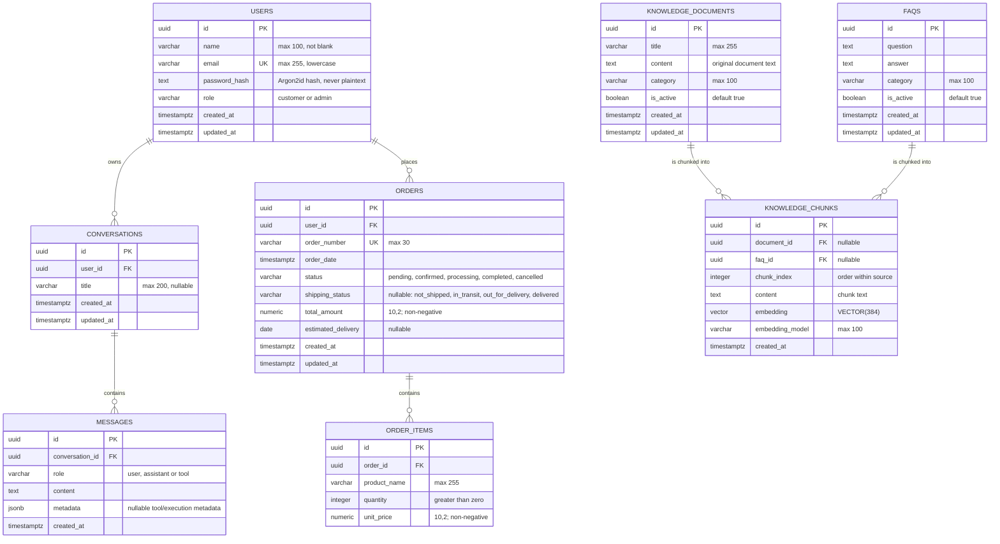

# Resolvix Database Design

- Status: implemented and verified
- Database: PostgreSQL 18 with pgvector 0.8.7
- Embedding model: `sentence-transformers/all-MiniLM-L6-v2` (384 dimensions)

## Architecture

Resolvix uses **one PostgreSQL database** for both relational data and vector
search. The relational tables store users, conversations, orders and the
original support knowledge. The `vector` extension adds the `VECTOR(384)` type,
cosine-distance search (`<=>`) and an HNSW index to the same database.

No Qdrant or other separate vector service is used.

```
FastAPI / SQLAlchemy
        |
        v
PostgreSQL 18  +  pgvector
   |                |
   |                +-- knowledge_chunks.embedding VECTOR(384)
   |                +-- HNSW index (vector_cosine_ops)
   |
   +-- users, conversations, messages
   +-- orders, order_items
   +-- faqs, knowledge_documents
```

## ERD



## Cardinalities

| Relationship | Cardinality | Foreign key |
|---|---|---|
| Users -> Conversations | 1:N | `conversations.user_id` |
| Conversations -> Messages | 1:N | `messages.conversation_id` |
| Users -> Orders | 1:N | `orders.user_id` |
| Orders -> OrderItems | 1:N | `order_items.order_id` |
| FAQs -> KnowledgeChunks | 1:N | `knowledge_chunks.faq_id` |
| KnowledgeDocuments -> KnowledgeChunks | 1:N | `knowledge_chunks.document_id` |

## Foreign-key delete behaviour

| Parent row deleted | Child rows | Rule | Reason |
|---|---|---|---|
| User | Conversations and their Messages | `ON DELETE CASCADE` | A conversation has no meaning without its owner. |
| User | Orders | `ON DELETE RESTRICT` | Orders are financial records and must not disappear silently. The application must explicitly handle/archive orders before removing a user. |
| Conversation | Messages | `ON DELETE CASCADE` | Messages belong to exactly one conversation. |
| Order | OrderItems | `ON DELETE CASCADE` | Line items belong to exactly one order. |
| KnowledgeDocument | KnowledgeChunks | `ON DELETE CASCADE` | Derived chunks must not outlive their source document. |
| FAQ | KnowledgeChunks | `ON DELETE CASCADE` | Derived chunks must not outlive their source FAQ. |

`ON DELETE CASCADE` is also configured on the SQLAlchemy relationships, so
deleting through the ORM and deleting through raw SQL behave consistently.

## Table constraints

### Users

- `id` UUID primary key, default `gen_random_uuid()`.
- `name` `VARCHAR(100) NOT NULL`, check that it is not blank.
- `email` `VARCHAR(255) NOT NULL UNIQUE`, check that it is lowercase.
- `password_hash` `TEXT NOT NULL`; new hashes use Argon2id. Legacy Phase 1
  PBKDF2 hashes remain verifiable and are upgraded on the next successful
  login or seed run.
- `role` `VARCHAR(20) NOT NULL DEFAULT 'customer'`, check in
  (`customer`, `admin`).
- `created_at`, `updated_at` `TIMESTAMPTZ NOT NULL DEFAULT NOW()`.
  `updated_at` is refreshed by SQLAlchemy on ORM updates.

### Conversations

- `user_id` UUID `NOT NULL`, FK to `users.id` with `ON DELETE CASCADE`.
- `title` `VARCHAR(200) NULL`; when present it must not be blank.
- Index: `ix_conversations_user_id`.

### Messages

- `conversation_id` UUID `NOT NULL`, FK to `conversations.id` with
  `ON DELETE CASCADE`.
- `role` `VARCHAR(20) NOT NULL`, check in (`user`, `assistant`, `tool`).
- `content` `TEXT NOT NULL`. Empty text is allowed so an assistant tool-call
  message can store its payload in `metadata`.
- `metadata` `JSONB NULL`. The SQLAlchemy attribute is called
  `message_metadata` because `metadata` is reserved by the declarative base.
- Composite index: `ix_messages_conversation_id_created_at`.

### Orders

- `user_id` UUID `NOT NULL`, FK to `users.id` with `ON DELETE RESTRICT`.
- `order_number` `VARCHAR(30) NOT NULL UNIQUE`.
- `order_date` `TIMESTAMPTZ NOT NULL`.
- `status` `VARCHAR(30) NOT NULL`, check in (`pending`, `confirmed`,
  `processing`, `completed`, `cancelled`).
- `shipping_status` `VARCHAR(30) NULL`, check in (`not_shipped`, `in_transit`,
  `out_for_delivery`, `delivered`).
- `total_amount` `NUMERIC(10,2) NOT NULL`, check `>= 0`.
- `estimated_delivery` `DATE NULL`.
- Index: `ix_orders_user_id`. The unique constraint on `order_number` supplies
  its own index.

Order status and shipping status are deliberately separate columns. The
authenticated user ID used by later application code must come from the trusted
backend authentication context, never from an LLM tool argument.

### OrderItems

- `order_id` UUID `NOT NULL`, FK to `orders.id` with `ON DELETE CASCADE`.
- `product_name` `VARCHAR(255) NOT NULL`, not blank.
- `quantity` `INTEGER NOT NULL`, check `> 0`.
- `unit_price` `NUMERIC(10,2) NOT NULL`, check `>= 0`.
- Index: `ix_order_items_order_id`.

### FAQs

- `question`, `answer` `TEXT NOT NULL`, not blank.
- `category` `VARCHAR(100) NOT NULL`, not blank.
- `is_active` `BOOLEAN NOT NULL DEFAULT TRUE`; inactive FAQs are excluded from
  retrieval by application code.
- Index: `ix_faqs_category`.

### KnowledgeDocuments

- `title` `VARCHAR(255) NOT NULL`, not blank.
- `content` `TEXT NOT NULL`; this is the original human-readable source and is
  never replaced by an embedding.
- `category` `VARCHAR(100) NOT NULL`, not blank.
- `is_active` `BOOLEAN NOT NULL DEFAULT TRUE`.
- Index: `ix_knowledge_documents_category`.

### KnowledgeChunks

- `document_id` UUID `NULL`, FK to `knowledge_documents.id` with
  `ON DELETE CASCADE`.
- `faq_id` UUID `NULL`, FK to `faqs.id` with `ON DELETE CASCADE`.
- Check `ck_knowledge_chunks_exactly_one_source`:
  `(document_id IS NOT NULL) <> (faq_id IS NOT NULL)`.
- `chunk_index` `INTEGER NOT NULL`, check `>= 0`.
- `content` `TEXT NOT NULL`, not blank.
- `embedding` `VECTOR(384) NOT NULL`.
- `embedding_model` `VARCHAR(100) NOT NULL`.
- Partial unique index `uq_knowledge_chunks_document_id_chunk_index` on
  `(document_id, chunk_index) WHERE document_id IS NOT NULL`.
- Partial unique index `uq_knowledge_chunks_faq_id_chunk_index` on
  `(faq_id, chunk_index) WHERE faq_id IS NOT NULL`.
- HNSW index `ix_knowledge_chunks_embedding_hnsw` using
  `vector_cosine_ops`.

The original text always lives in `faqs` or `knowledge_documents`. Chunks are
derived and can be deleted and regenerated without losing source content.

## Required indexes

| Index | Table / columns | Purpose |
|---|---|---|
| `uq_users_email` | `users(email)` (unique) | Login lookup and duplicate prevention |
| `ix_conversations_user_id` | `conversations(user_id)` | List a user's conversations |
| `ix_messages_conversation_id_created_at` | `messages(conversation_id, created_at)` | Ordered conversation history |
| `uq_orders_order_number` | `orders(order_number)` (unique) | Order lookup and uniqueness |
| `ix_orders_user_id` | `orders(user_id)` | List a user's orders |
| `ix_order_items_order_id` | `order_items(order_id)` | Load order line items |
| `ix_faqs_category` | `faqs(category)` | Category filtering |
| `ix_knowledge_documents_category` | `knowledge_documents(category)` | Category filtering |
| `uq_knowledge_chunks_document_id_chunk_index` | partial unique | One chunk index per document |
| `uq_knowledge_chunks_faq_id_chunk_index` | partial unique | One chunk index per FAQ |
| `ix_knowledge_chunks_embedding_hnsw` | `knowledge_chunks.embedding` HNSW | Cosine-distance vector search |

## Vector design

| Setting | Choice |
|---|---|
| Database | PostgreSQL 18 |
| Extension | `vector` 0.8.7 (`CREATE EXTENSION IF NOT EXISTS vector`) |
| Embedding model | `sentence-transformers/all-MiniLM-L6-v2`, local, no paid API |
| Dimensions | 384 |
| Similarity | Cosine distance, operator `<=>` |
| Index | HNSW with `vector_cosine_ops` |
| Storage | `knowledge_chunks.embedding` |
| Separate vector service | None; no Qdrant in the initial release |

### Chunking safeguard

`all-MiniLM-L6-v2` truncates input beyond 256 word pieces. Do not use a blind
500-token chunk. Phase 5 ingestion should:

1. Confirm `model.max_seq_length` in code after loading the model.
2. Start with token-aware chunks around **180-220 model tokens** and a small
   overlap (for example 20-40 tokens).
3. Store the model identifier/version in `knowledge_chunks.embedding_model`.
4. Re-run retrieval evaluation and adjust chunk size/overlap if quality is poor.

Chunking and embedding are intentionally not implemented in Phase 1;
`knowledge_chunks` is empty after seeding.

## Index and source refresh strategy

When a source changes:

1. Update the row in `faqs` or `knowledge_documents`.
2. In one transaction, delete the source's existing `knowledge_chunks` and
   insert the newly chunked/embedded rows.
3. Commit. If any step fails, the old chunks remain because the transaction
   rolls back.

When a source is deleted, the `ON DELETE CASCADE` foreign keys remove its
chunks. This is covered by `scripts/verify.py`.

## Seed data

`python -m scripts.seed` creates:

- 7 synthetic customers + 1 administrator.
- 12 orders with 23 order items.
- 12 FAQs across 8 categories.
- 4 knowledge documents with original multi-paragraph content.
- 0 knowledge chunks (left for Phase 5 ingestion).

Demo accounts (local development only):

| Role | Email | Password |
|---|---|---|
| Admin | `admin@resolvix.local` | `Admin123!` |
| Customer | `alice.morgan@example.com` | `Customer123!` |

All customer records use `example.com` addresses. No real customer data is
used.

## Commands

Run from `backend/`:

```powershell
# Apply the schema
.\venv\Scripts\python.exe -m alembic upgrade head

# Seed synthetic data (idempotent)
.\venv\Scripts\python.exe -m scripts.seed

# Verify schema, constraints, CRUD, vector search and cascades
.\venv\Scripts\python.exe -m scripts.verify

# Confirm models and migration have no differences
.\venv\Scripts\python.exe -m alembic check
```

For a clean-schema check:

```powershell
# Warning: downgrade drops all application tables and their data.
.\venv\Scripts\python.exe -m alembic downgrade base
.\venv\Scripts\python.exe -m alembic upgrade head
.\venv\Scripts\python.exe -m scripts.seed
.\venv\Scripts\python.exe -m scripts.verify
```

The migration creates the `vector` extension before the `knowledge_chunks`
table. The extension is not dropped on downgrade because it may be shared with
other schemas in the same database instance.

## pgvector setup

See [`pgvector-setup.md`](pgvector-setup.md) for PostgreSQL/pgvector
installation notes, including the Windows setup used for this project.
